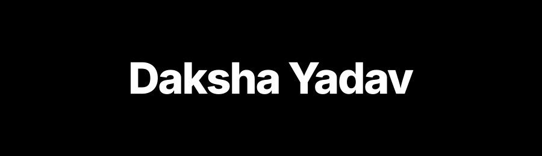
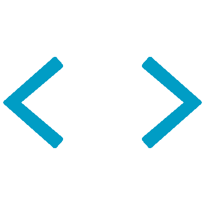

  

##  About

I enjoy building software, exploring ideas, and understanding how things work under the hood. Most of my learning happens through experimentation and turning ideas into working projects.

  

##  Featured Projects

<table>
  <tr>
    <td width="50%" valign="top">
      
      <h3 align="left"><a href="https://github.com/TheQuantumPanda/TripWeave">TripWeave</a></h3>
      
An AI-powered travel-planning workspace that coordinates specialized agents to create grounded, budget-aware itineraries, with human review before finalization. Emphasizes supervisor-driven multi-agent orchestration, external tool integrations via Model Context Protocol (MCP), a human-in-the-loop workflow using LangGraph interrupts, and persistent conversation state in PostgreSQL checkpoints.

      
<strong>Technologies:</strong> React, TypeScript, FastAPI, LangGraph, MCP, PostgreSQL

      

        <a href="https://github.com/TheQuantumPanda/TripWeave">Repository</a> &nbsp;|&nbsp;
        <a href="https://tripweave-mq1h.onrender.com">Live Demo</a>
      

    </td>
    <td width="50%" valign="top">
      
      <h3 align="left"><a href="https://github.com/TheQuantumPanda/TallyNest">TallyNest</a></h3>
      
A full-stack financial workspace for personal transactions, monthly budgets, recurring payments, and collaborative group expenses. Emphasizes exact integer currency arithmetic (paise) to prevent floating-point drift, concurrency-safe financial write operations via a reservation coordinator, and isolated settlement cycles. <em>(Hosted demo uses test data; not certified for real financial records).</em>

      
<strong>Technologies:</strong> React, TypeScript, Node.js, Express, MongoDB

      

        <a href="https://github.com/TheQuantumPanda/TallyNest">Repository</a> &nbsp;|&nbsp;
        <a href="https://tallynest-plum.vercel.app">Live Demo</a>
      

    </td>
  </tr>
  <tr>
    <td width="50%" valign="top">
      
      <h3 align="left"><a href="https://github.com/TheQuantumPanda/resumeiq">ResumeIQ</a></h3>
      
A resume-to-role matching workspace that combines transparent keyword compatibility analysis with AI-assisted writing feedback. Emphasizes client-side PDF processing via PDF.js, explainable keyword matching with inspectable coverage denominators, validated AI feedback via Zod, and saved review workflows in Puter. <em>(Compatibility analysis provides an explainable comparison, not an employer ATS score or hiring prediction).</em>

      
<strong>Technologies:</strong> React Router, TypeScript, PDF.js, Zod, Puter

      

        <a href="https://github.com/TheQuantumPanda/resumeiq">Repository</a> &nbsp;|&nbsp;
        <a href="https://resumeiq-ashen.vercel.app/">Live Demo</a>
      

    </td>
    <td width="50%" valign="top">
      
      <h3 align="left"><a href="https://github.com/TheQuantumPanda/CrewFlow">CrewFlow</a></h3>
      
A workforce and task-management workspace for organizing employees, departments, task ownership, and progress through role-based workspaces. Emphasizes multi-tier role-based permissions, department-scoped workflows, task management, and structured audit history.

      
<strong>Technologies:</strong> React, TypeScript, Flask, PostgreSQL, Docker

      

        <a href="https://github.com/TheQuantumPanda/CrewFlow">Repository</a> &nbsp;|&nbsp;
        <a href="https://crewflow-a18v.onrender.com/">Live Demo</a>
      

    </td>
  </tr>
</table>

  

##  Technologies I Work With

<table>
  <tr>
    <td width="28%" valign="middle"><strong>Languages</strong></td>
    <td valign="middle">
      &nbsp;TypeScript &nbsp;&bull;&nbsp;
      &nbsp;JavaScript &nbsp;&bull;&nbsp;
      &nbsp;Python
    </td>
  </tr>
  <tr>
    <td width="28%" valign="middle"><strong>Frontend &amp; UI</strong></td>
    <td valign="middle">
      &nbsp;React &nbsp;&bull;&nbsp;
      &nbsp;React Router &nbsp;&bull;&nbsp;
      <code>PDF.js</code>
    </td>
  </tr>
  <tr>
    <td width="28%" valign="middle"><strong>Backend &amp; APIs</strong></td>
    <td valign="middle">
      &nbsp;Node.js &nbsp;&bull;&nbsp;
      &nbsp;Express &nbsp;&bull;&nbsp;
      &nbsp;FastAPI &nbsp;&bull;&nbsp;
      &nbsp;Flask
    </td>
  </tr>
  <tr>
    <td width="28%" valign="middle"><strong>AI &amp; Agentic Systems</strong></td>
    <td valign="middle">
      &nbsp;LangGraph &nbsp;&bull;&nbsp;
      &nbsp;Model Context Protocol (MCP)
    </td>
  </tr>
  <tr>
    <td width="28%" valign="middle"><strong>Databases &amp; Storage</strong></td>
    <td valign="middle">
      &nbsp;PostgreSQL &nbsp;&bull;&nbsp;
      &nbsp;MongoDB
    </td>
  </tr>
  <tr>
    <td width="28%" valign="middle"><strong>DevOps, Testing &amp; Tooling</strong></td>
    <td valign="middle">
      &nbsp;Docker &nbsp;&bull;&nbsp;
      &nbsp;Pytest &nbsp;&bull;&nbsp;
      &nbsp;Playwright &nbsp;&bull;&nbsp;
      &nbsp;Zod &nbsp;&bull;&nbsp;
      <code>Puter</code>
    </td>
  </tr>
</table>

  

